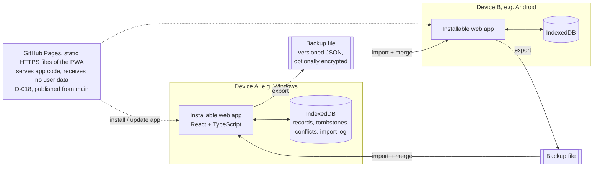
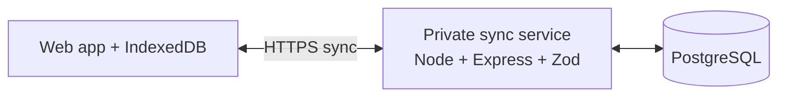

# Architecture

## Goals

Support offline daily use on Windows 11 and Android, keep iPhone installability feasible, and preserve trustworthy history. **Version 1** is an installable PWA (D-013) that keeps data only on each device and moves it between devices with a merged backup file (DECISIONS D-008 to D-017). Automatic sync between a single owner's devices is a later, optional addition. Keep the implementation understandable and recoverable.

## Version 1 shape

User data never leaves a device except in a backup file the user exports.

**What still needs internet in v1.** Daily use after installation works offline. Installing the app the first time and receiving app updates need internet: v1 is an installable PWA (D-013), so the app files are downloaded from a web address (HTTPS is required for the service worker and for installation on Android and iPhone), and updates are fetched from the same address when the device is online. Native wrappers are not part of v1. GitHub Pages is the selected host (D-018), with the stable URL `https://moeintorabi90.github.io/personal-productivity-system/`, published from `main` by the workflow below. **Live-site status (latest check 2026-10-29, from the development PC):** the latest successful deployment is workflow run 40204321817 for `7fabdcd` (2026-10-25); the app, manifest, service worker, and bundle returned HTTP 200 and the served bundle identified version 0.6.0. History: the URL returned HTTP 404 on 2026-10-23; the deployment of `fe83acf` restored it and served version 0.4.0 (2026-10-25). The owner installed the app from this URL on a Windows laptop and an Android phone and reports (2026-10-23) that offline use and backup transfer between them work (TESTING, "Owner device checks (2026-10-23)"). Still open: iPhone and the remaining "(verify)" items below; reachability from the owner's region is known only from the owner's own installation.

**Hosting on GitHub Pages (D-018).** The workflow (`.github/workflows/deploy-pages.yml`) runs on every push to `main` (and manually): `npm ci`, typecheck, the Vitest suite, and the production build; then it publishes only `apps/web/dist` to Pages. Nothing else is deployed: no API, sync service, database, accounts, or secrets, and the frozen sync UI stays off (`VITE_ENABLE_FROZEN_SYNC` is not set). The site is a GitHub **project site**, so the app lives under the path `/personal-productivity-system/`: production builds use that Vite `base` (`APP_BASE_PATH` in `apps/web/vite.config.ts`; the dev server stays at `/`), the service worker is registered at `<base>sw.js` with scope `<base>`, and the manifest's `id`, `start_url`, and `scope` (relative `./`) and icons resolve inside that path. The E2E tests serve the build under the same path and fail on any request outside it. The path is part of the installed app's identity (manifest `id`, service-worker scope), so it must not change once the app is in use; renaming the repository changes it.

**Local data is tied to the app's origin.** Browsers store IndexedDB and the service-worker cache per **origin**: the combination of scheme, host, and port (e.g. `https://app.example.org:443`). The path does not matter, so `…/index.html` and `…/settings` share data, but `http://` vs `https://`, a different host or subdomain, or a different port is a separate origin with separate, empty storage. Changing the origin later makes existing local data invisible to the new one; a backup export/import is the migration path. The origin should therefore be chosen once and kept stable.

**Trust in whoever serves the app code.** A static host never receives user data from the app, but it delivers the code that runs with full access to that origin's local data. If code served from that origin is malicious or tampered with (a compromised hosting account, a modified build, a hijacked domain), it can technically read, change, or send the local data. Mitigations to weigh with the hosting decision: HTTPS only; strong protection (2FA) of the hosting and domain accounts; reproducible builds from this repository; no third-party scripts and a strict Content-Security-Policy; showing the app version and applying updates visibly. The selected host is GitHub Pages (D-018); the code is built from this public repository by its workflow, so the GitHub account (2FA), the repository, and its Actions configuration are what must be protected. **Shared origin:** all GitHub Pages sites of one account share the origin `https://moeintorabi90.github.io`, and local data is per origin, not per path. Any other Pages site published from the same account (another project repository, or a `moeintorabi90.github.io` user site) would run with full access to this app's local data. Therefore no other Pages site should be published from that account unless its code is equally trusted; moving to a custom domain later would be a new origin (data moves by backup export/import). GitHub Pages does not let a site set a Content-Security-Policy header (only a `<meta>` CSP is possible), which is a known limitation. Reachability from the owner's region is known only from the owner's own installation.

### Platform installation, updates, and storage (v1, D-013)

The statements below describe documented or commonly observed browser behavior. Items marked **(verify)** have not been checked on a real device for this app yet; the device checks in ROADMAP Stage 1/1B confirm or correct them. Browser behavior changes between versions, so record the device, OS, and browser version with every check. Owner reports: the app was installed on a Windows laptop and an Android phone (2026-10-21), and on 2026-10-23 offline use, persistence after reopening, and backup export/import in both directions were reported as working (TESTING, "Owner device checks (2026-10-23)"). Device, OS, and browser versions were not provided, and the report does not cover the specific items below, so they stay **(verify)**.

**All platforms**

- **Install** needs internet and the app's HTTPS URL, `https://moeintorabi90.github.io/personal-productivity-system/` (D-018), which was serving version 0.6.0 (deployed from `7fabdcd`) at the latest check on 2026-10-29. During development, `localhost` is the only exception.
- **Updates** need internet. When the installed app is opened online, the browser checks for a new service worker; the v1 service worker installs the new version in the background and activates it immediately, but the open window keeps running the old code until the app is reloaded or relaunched. Offline, the last installed version keeps working indefinitely. Updates never touch local data; data-format changes run as tested local migrations.
- **Storage scope:** local data belongs to one browser (or browser profile) **and** one origin. Another browser, another browser profile, or (on iPhone) Safari tabs versus the Home Screen app have separate, independent storage.
- **Losing data:** uninstalling the app with its data, clearing site or browser data, resetting the device, or browser eviction under storage pressure deletes local data. **Only exported backup files protect against this.**
- **Persistent storage:** the app asks the browser to mark its storage as persistent (`navigator.storage.persist()`); the browser decides whether to grant it, and granting reduces but does not eliminate eviction risk. The "last backup" indicator (Stage 1B) is the user's main signal.

**Windows 11 — Microsoft Edge**

- Install from Edge ("Install this site as an app" from the address bar or the Apps menu). The app gets its own window and a Start menu entry.
- Data lives in the Edge profile used for installing; another Edge profile or another browser starts empty.
- Chromium-based browsers allow a large storage quota (a share of free disk space). Eviction under disk pressure is possible for non-persistent storage; whether Edge grants persistent storage to the installed app **(verify)**.
- Uninstalling offers to clear the app's data as well; choosing it deletes local data.
- Verified so far (automated, headless Edge 155): offline reload of the installed shell, data surviving a browser restart and an offline reopen. The install UI itself has not been tested.

**Android — compatible browser**

- Targets are Chromium-based browsers (Chrome; Edge and Samsung Internet are expected to behave similarly **(verify)**). Other browsers may only offer a home-screen shortcut with different offline/storage behavior and are not targets until verified.
- Install from the browser menu ("Install app" / "Add to Home screen"). Chrome creates a WebAPK that looks like a normal app.
- Data lives inside the browser that installed the app. Installing from Chrome but opening the site in another browser shows empty, separate storage. Clearing that browser's storage in Android settings deletes the app's data.
- Eviction under low storage is possible unless persistent storage is granted **(verify)**; app name/icon changes may take a while to reach an installed WebAPK.
- Backup export via the share sheet or a download; import via the system file picker **(verify)**.

**iPhone — Safari**

- Install only via Safari → Share → **Add to Home Screen**; iOS shows no automatic install prompt, so the app should show a short instruction.
- The Home Screen app has **its own storage, separate from Safari tabs**: data entered in a Safari tab is not visible in the installed app and vice versa. Users should use only the installed app.
- **Storage retention:** in Safari, WebKit deletes script-writable storage (including IndexedDB) of websites the user has not interacted with during seven days of browser use. According to WebKit, this seven-day deletion **does not apply to web apps added to the Home Screen**. That does **not** make the data permanent: it is still deleted when the user removes the Home Screen app or clears website data, and it may still be evicted when the device is under storage pressure. **Long-term retention is not guaranteed** **(verify the current behavior on a real device with the target iOS version)**. Regular backups are essential on iPhone.
- Deleting the Home Screen app deletes its data.
- Updates are fetched when the app is opened online; iOS may keep a suspended app on its old code until it is fully closed and reopened.
- No background sync (not needed in v1). Notifications are only possible for Home Screen apps on newer iOS versions and are not part of v1.
- Backup export via the share sheet (save to Files) and import via the Files picker; selecting `.json` files **(verify)**. Storage quotas differ by iOS version **(verify)**.
- The minimum supported iOS version is to be set after device testing.

### After v1 (not built now)

The Stage 1 sync API, authentication, PostgreSQL schema, and client sync engine stay in the repository but are **frozen and inactive** in v1 (D-016): no sync service is developed or run. A future sync would exchange the same record envelopes as backups (T-016); the frozen code would be reviewed first and may need changes.

The installable PWA is the v1 delivery method (D-013) because it shares one interface across Windows, Android, and iPhone while storing local data. Its offline and installation behavior, and file import/export on each platform, must still be verified on real devices. If a critical requirement fails on a platform, report it to the owner; a native wrapper would be a new product decision.

## Main components

- **Client app:** React, TypeScript, Vite, accessible UI, semantic CSS tokens, i18n. English default; Persian RTL; theme and date display preferences.
- **Local persistence:** IndexedDB through a small typed repository layer (Dexie). It is the only data store in v1. Every record uses the envelope of T-016 (UUID, timestamps, version vector, content hash); deletions keep tombstones. The repository layer, not the UI, enforces domain rules (relationships, history immutability), so the same rules apply to typed-in and imported data.
- **Backup module (v1):** export, validation, versioned upgrade chain, import preview, atomic merge, pending conflicts, replaced-version archive, and import log, as specified in `BACKUP_FORMAT.md`. Optional per-export password encryption via Web Crypto (AES-GCM, PBKDF2), off by default (D-014).
- **Offline assets:** service worker caches the versioned application shell. Updating the app must not erase local records; local data schema upgrades run in IndexedDB version upgrades and are tested like backup upgrades.
- **Shared packages:** shared schemas/types (also the backup schemas) and a separate date/time package for timezone-safe local-date, week-boundary, recurrence, and Gregorian/Jalali display behavior.
- **App delivery (v1):** installable PWA (D-013) delivered as static files over HTTPS, with GitHub Pages as the selected host (D-018; live-site status above). No user data on any server; the app code's source must be trusted (see above).
- **After v1 only:** sync client (outbox), private sync API (Express/Zod), PostgreSQL. Built in Stage 1; frozen and inactive in v1 (D-016).

## Local-first model and backup merge (v1)

1. Every create/edit is saved to the local database and shown immediately. Each local edit increments this device's counter in the record's version vector.
2. Export writes all records and tombstones into one versioned file.
3. Import validates the whole file first, then previews: new, already here, older copy, newer in backup, conflict, deleted here/in backup. Only new items are added automatically; everything else that would change existing data needs the user's explicit choice. Applying is one atomic transaction (`BACKUP_FORMAT.md`).
4. Conflicts keep both versions until resolved; the replaced version is archived for undo.
5. Historical records are immutable events; corrections are separate records, so merging history is append-only.

## Synchronization model (after v1, reference for the frozen Stage 1 code)

1. Every ordinary create/edit operation is first saved to the local database and shown immediately.
2. A queued operation is sent when online. Every operation has a stable UUID/idempotency key so retries do not duplicate data.
3. The server authenticates the owner, validates all IDs and relationships, applies changes transactionally, assigns the canonical revision, and returns accepted revisions and any conflicts.
4. The client pulls changes after its last server cursor and applies them locally. Tombstones are retained long enough for offline devices to learn about deletions.
5. If two devices edit the same mutable definition from the same base revision, the server returns a conflict. The UI shows the two values and asks the owner to choose or combine them. It does not silently discard a change.
6. Historical records are immutable events. Corrections create an auditable correction record. A locally recorded session carries references to the task/project/workstream revisions it observed; sync operations are ordered so the server can validate relationships and create canonical snapshots.
7. The sync API is not the only recovery path: export and backup/restore must work independently of device sync.

## Data flow boundaries

- In v1 the device's domain layer is authoritative: goal and dashboard calculations use shared, documented domain logic, and the same validation applies to imported records. (With a future sync service, the server would become authoritative for identity, ownership, and canonical revisions.)
- Snapshots that must not change (session/block snapshots, finalized reviews) are captured locally at the time of the event and travel unchanged in backups.
- Calendar blocks represent planned occurrences. Execution sessions represent actual work. Neither is a substitute for the other.
- All instants are stored as UTC timestamps; date-only concepts use local date keys and explicit timezone context. Jalali is a display/calendar option, not an implicit timezone or arithmetic mode.

## Security and privacy outline

**Version 1:**

- User data stays on the device; there is no network traffic carrying user data. The app host (if used) only serves app files, but the code it serves can access the origin's local data, so the host, domain, and build pipeline are part of the trust boundary.
- Data at rest in IndexedDB is protected by the device's lock and storage encryption; the app does not add its own encryption in v1.
- A backup file contains all personal data. Password encryption is optional per export and off by default (D-014); an unprotected file is readable by anyone who gets it, and a forgotten password makes a protected file impossible to restore (`BACKUP_FORMAT.md`). A recovery key is not part of v1.
- Imported files are untrusted input: size limits, full schema validation, reference checks, and no execution of anything from the file; text from files is rendered as text only.
- A strict Content-Security-Policy on the app host, and no third-party scripts.

**After v1 (sync service):**

- HTTPS in transit; secure credential/session storage; server-side authorization on every query/mutation.
- Private service account for the owner and an explicit device enrollment/revocation flow.
- Secrets stored in environment configuration and excluded from Git.
- Encryption-at-rest and whether end-to-end encryption is required are open decisions. Do not promise end-to-end encryption unless the design and recovery model support it.

Known limitations of the frozen Stage 1 server code, to address before it is ever used with real data:

- The bearer token is stored in IndexedDB, so any script injected into the page could read it. A strict Content-Security-Policy (set by the hosting layer) and avoiding third-party scripts are required; HttpOnly cookies are an alternative to evaluate with the hosting choice.
- The failed-login limiter is in memory (one process) and keys on `req.ip`; behind a reverse proxy, `trust proxy` must be configured or all clients share one key.
- No CORS headers are sent: the web app and API are expected to share an origin (Vite proxies `/v1` in development).
- `SETUP_TOKEN` is optional only while the API listens on loopback (the default, T-015); production and any non-loopback `HOST` refuse to start without it. Without a token, any program on the same computer can still complete first-run setup until it is done.
- No account recovery flow exists yet (open decision 3).

## Stage 1 implementation notes

- **Client:** React 19 + Vite 8, Dexie 4 over IndexedDB, typed in-house i18n (T-009), CSS tokens for light/dark/system themes and logical properties for RTL. A hand-written service worker precaches the versioned shell and never caches `/v1` API responses (T-008). Before sign-in the app works fully on the device and queues nothing for preferences; diagnostic notes queue and sync after sign-in.
- **Sync API:** Express 5 + Zod 4 on Node 24, run as TypeScript through Node's type stripping. Data access is plain SQL behind a two-method `Db` interface implemented by PGlite (dev/test) and `pg` (PostgreSQL) (T-006, T-007).
- **Repository layout:** one root `package.json` with path aliases because the drive is exFAT (T-014).

## Stage 1B implementation notes

- **Backup module** (`apps/web/src/backup/`): `limits.ts` (format-version-1 limits), `scan.ts` (constant-memory pre-parse scan), `jcs.ts`, `sha256.ts` (synchronous, for content hashes inside IndexedDB transactions; Web Crypto for file integrity), `format.ts` (strict header/encryption/payload schemas), `read.ts` (validation order steps 1–8), `crypto.ts` (PBKDF2/AES-GCM via Web Crypto), `merge.ts` (preview and one-transaction apply), `conflicts.ts` (resolutions, bulk, undo), `export.ts` (export with re-open verification), `deliver.ts` (download / share sheet), `registry.ts` (record types allowed in product backups: `preferences` only for now).
- **Local data:** IndexedDB schema version 2 with `records`, `tombstones`, `pendingConflicts`, `replacedVersions`, `importLog` (DATA_MODEL); `local/records.ts` for local edits (version-vector bump, tombstones), `local/settings.ts` for shared preferences.
- **UI:** Backup screen (export with optional password, import with preview, conflicts, undo), last-backup indicator in the header, install guide on Home.
- **Frozen sync code (D-016):** hidden and never started unless the development build flag `VITE_ENABLE_FROZEN_SYNC=true` is set; the code itself was not changed.

## Stage 2 implementation notes

- **Record types:** `projects`, `workstreams`, `taskDefinitions` in the backup registry (`backup/registry.ts`) with schemas, links, an immutable workstream project, and the task relationship rule; exported with `dataSchemaVersion` 2 (DECISIONS T-020 to T-024; DATA_MODEL "Stage 2 record types").
- **Rules in one place:** `putRecord` (`local/records.ts`) now checks for every typed-in write that links point to live records, the type's rule holds, and immutable fields keep their value; the import applies the same registry rules to every version in a file. No IndexedDB schema change.
- **Domain module:** `local/organization.ts` — commands (capture, create, edit, move, archive/restore) and pure queries (inbox, search across all three types with Persian/Arabic letter folding, active/archived filter, project outline grouped by workstream).
- **UI:** Inbox (quick capture, search, filter, edit/organize, archive) and Projects (list, search across projects/workstreams/tasks, filter, create; project detail with workstreams, tasks grouped by workstream, and tasks directly in the project). The Backup screen labels the new types and fields and shows project/workstream names instead of IDs in conflicts.

## Stage 3 design and implementation notes (implemented on `feat/stage-3-calendar-planning`, 2026-10-24)

Contract: PRODUCT_SPEC "Stage 3 planning contract"; decisions D-019 to D-023 and T-025 to T-036 (T-029 to T-036 approved by the owner, 2026-10-24). The components below are technical design choices, not owner decisions.

Where it lives:

- **Date/time module** `apps/web/src/planning/time.ts` (pure, `Intl` only; no new dependency): local date and wall time of an instant in a zone, UTC offset, `resolveWallTime` (gap refused, ambiguous → earlier instant with its offset), local-day bounds by a minute-precision search (handles 23/25-hour days and days that start after midnight), week dates, Gregorian and Jalali month dates, Jalali conversion (ICU's Persian calendar).
- **Derived planning** `apps/web/src/planning/planning.ts` (pure): recurrence on a date, unscheduled items, "scheduled" (at least one planned block with that task and `occurrenceDate`), blocks displayed on a date, day clipping, planned minutes, overlaps and side-by-side groups, capacity status, search and filters.
- **Commands** `apps/web/src/local/planning.ts`: create block, schedule an occurrence, quick add (inbox task + block in one transaction), edit (move/resize), cancel/restore; recurrence is set through `updateTask` (`recurrence: null` removes the field). `local/planning-error.ts` refuses planning writes without a configured zone. Capacity is a shared preference (`updateSharedPreferences`, `null` removes the field).
- **Registry:** `calendarBlocks` (since data version 3; link `taskId` → `taskDefinitions`; block rules in its schema, so they apply to every version in a file) and per-version field schemas (`olderSchemas`) for `taskDefinitions` and `preferences`, used by `registryForDataSchemaVersion`. `DATA_SCHEMA_VERSION` = 3. No IndexedDB schema change and no date index (blocks are read from `records` by type).
- **UI:** `Today` and `Calendar` screens (`TodayView.tsx`, `CalendarView.tsx`), shared pieces in `planning-ui.tsx` (block form, rows, capacity summary, day panel, date entry in the display calendar, zone prompt); recurrence fields and a "Plan" action in the task editor/rows; capacity and the zone-change note in Settings; Backup screen labels for the new type and fields.

Design:

- **Planning stays local and separate from execution:** one new record type, `calendarBlocks` (plans only), plus optional fields on task definitions (`recurrence`) and shared preferences (`dailyCapacityMinutes`). No server, sync, or account is involved; the frozen sync code is untouched (D-016).
- **No scheduler component.** Nothing runs in the background to place, move, or cancel work. Unscheduled items and capacity are **pure, derived computations** over tasks, blocks, preferences, and a date range, recomputed on display (D-019, D-021, T-026). Only explicit user actions write blocks. Whether an occurrence is scheduled is computed from its blocks' `occurrenceDate` and status (at least one planned block; D-023), never from the date on which a block is displayed, so a time-zone change (which writes no block; D-022) cannot create a duplicate unscheduled item.
- **Date/time module** (pure functions, unit-tested; in the web app's domain layer): local date of an instant in a zone, the instants of a local wall time (refusing daylight-saving gaps, choosing the earlier instant for overlaps and reporting its offset; T-030), weekday of a local date, week range from the configured week start, month ranges in the Gregorian and Jalali display calendars (T-035), day clipping of blocks for capacity. Built on the platform's `Intl` time-zone data; any new date library would be a dependency decision to raise first.
- **Calculations read only the shared time zone** (D-020, T-028); language and display calendar affect formatting only.
- **Backup:** registry entries for the new type and version-aware schemas for `taskDefinitions` and `preferences` (version 2 vs 3); validation, links, and relationship rules as in BACKUP_FORMAT "Data schema version 3". No IndexedDB data rewrite; an optional date index for blocks would be a schema step without data changes (not needed so far).
- **UI:** Calendar (day/week/month, navigation, search/filters), Today, block forms (create/schedule/quick add/edit/cancel/restore), capacity setting in Settings, warnings in views. All forms keyboard- and screen-reader-accessible, English and Persian, LTR/RTL.

## Stage 4 implementation notes (goals and milestones, branch `feat/stage-4-goals`, 2026-10-25)

Contract: PRODUCT_SPEC "Goals and measures" and "Stage 4 goal and milestone rules"; decisions T-037 to T-065, T-077 to T-080 (owner) and T-081 to T-087 (derived).

- **Registry:** `goals` (link `projectId` → `projects`; immutable `kind`) and `milestones` (link `goalId` → `goals`; immutable `goalId`), both since data version 4. Shape rules (deadline ≥ start, unit only on output goals, target limits per kind) are in the schemas, so they apply to every version in a file. `DATA_SCHEMA_VERSION` = 4; no field of an older type changed, so no `olderSchemas` entry and no IndexedDB change.
- **Commands** `apps/web/src/local/goals.ts`: create/edit goal, status changes (pause, resume, complete, reopen), archive/restore, create/edit/complete/reopen/delete milestone. They refuse edits of an archived goal, check a milestone deadline against the goal's range, and refuse goal date changes that would put a milestone outside it (T-078). The range is not a registry rule (T-084); pure helpers (`deadlineWithinGoal`, `milestonesOutside`, `canChangeStatus`, `filterGoals`, `defaultStartDate`) are unit-tested.
- **UI:** `GoalsView.tsx` (list with status filter, create form, detail with status/archive actions, milestones with an inline delete confirmation and an "outside the goal's dates" warning). Dates use the existing display-calendar date entry (`DateField`); time targets are entered as hours and minutes. Goal and milestone fields are labelled in the backup conflict view. No progress is computed or displayed (T-087).

## Stage 3 follow-up implementation notes (2026-10-25; developed on `feat/calendar-follow-up`, merged into `main` at `7fabdcd` and deployed as 0.6.0)

Contract: PRODUCT_SPEC "Stage 3 follow-up"; decisions T-066 to T-070, T-075, T-088 to T-090 and the derived technical choices in DECISIONS.

- **Registry and data:** `projects.color` (optional enum of the 8 palette identifiers, `PALETTE_IDS` in `backup/registry.ts`), with the version 2–4 project schema kept in `olderSchemas`; `DATA_SCHEMA_VERSION` = 5. No IndexedDB change and no rewrite of stored records; `updateProject(…, { color: null })` removes the field.
- **Colors** `apps/web/src/planning/colors.ts` (pure): FNV-1a 32-bit, `defaultColorOf`, `projectColor`, `itemColor` (current project of the task, else the snapshot's project, else neutral). Theme values are CSS custom properties `--pal-<id>-accent` / `--pal-<id>-tint` in `styles.css` for light and both dark rules; `planning/colors.test.ts` reads those tokens and checks every contrast requirement.
- **Grid geometry** `apps/web/src/planning/grid.ts` (pure): wall-clock minutes per local date, 15-minute snapping, 30-minute tap, range selection, move and resize targets with real durations across daylight-saving changes (gaps refused), segment placement for blocks crossing midnight, side-by-side lanes for overlaps.
- **Commands** `apps/web/src/local/planning.ts`: `dragBlockTimes` (the `updateBlock` edit, refused for a cancelled block, returning the times before and after and the version written) and `undoBlockTimes` (writes the previous instants, zone, and local date as a new version with a refreshed snapshot; refused with `CHANGED` when the block's version is no longer the one the drag wrote).
- **UI:** `TimeGrid.tsx` (Pointer Events; mouse drags after 4 px; touch drags after a 400 ms long press, while a moving finger scrolls or, on a phone, swipes the shown days; resize handles drag at once; a non-passive `touchmove` listener stops scrolling only during a drag), `UndoBar.tsx` (5 seconds, kept while focused, hidden when the block changes), `CalendarView.tsx` (Layout grid/list, phone two-day view below 560 px with Previous/Next days), project color select and swatches in `ProjectsView.tsx`, colored rows in `planning-ui.tsx`, color labels in the backup conflict view.

## Design outline: Stage 5 sessions and outputs (contract recorded 2026-10-26; implemented on `feat/stage-5-sessions-outputs`, not merged; see the implementation notes below)

Contract: PRODUCT_SPEC "Actual work and outputs"; decisions T-091 to T-108, T-117, T-118, T-120 to T-125, T-129 to T-145, T-153 to T-159, T-162, T-163, T-165, T-166, T-168, T-169 (owner) and T-109 to T-116, T-119, T-126 to T-128, T-146 to T-152, T-160, T-161, T-164, T-167 (derived); data: DATA_MODEL "Stage 5 record types (proposed)"; backup: BACKUP_FORMAT "Data schema version 6". Everything below is a technical design choice, not an owner decision.

- **Registry (data version 6):** new types `sessions`, `outputDefinitions`, `outputRecords`, `corrections` (append-only), `taskCompletions`; optional fields `goals.definitionId`, `taskDefinitions.goalIds`, `taskDefinitions.outputDefinitionIds`, `calendarBlocks.expectedOutputs`, with the version-5 schemas of `goals`, `taskDefinitions`, and `calendarBlocks` kept in `olderSchemas`; the version-6 goal schema lets output goals with `definitionId` omit `unit` (T-161). No stored record is rewritten; records stay in the existing `records` store.
- **Commands** (local domain layer, like `local/goals.ts`): start, pause, resume, end, record past, edit, link to a block, delete, restore, and empty the trash for sessions; record, correct, re-attribute, delete, and restore outputs; complete, reopen, and complete again for tasks and occurrences; link tasks to goals and suggested definitions; choose a definition for an existing output goal. They enforce the one-open-session rule (T-092, T-117), the 24-hour limit on work time (T-136, T-158), same-task block links (T-094, T-135), "linked goal or none" (T-129, T-130), same-definition attribution (T-137), one unit per definition (a different unit is a new definition, T-165, T-167), a matching unit when an existing output goal is linked (T-166; singular and plural forms match, T-168; a pure matching function returns match, mismatch, or unknown, and on unknown the command links only with the owner's explicit, one-off confirmation, T-169, storing no alias; the function's method — rules, a reviewed list of irregular forms, or a library, which would be a dependency decision raised first — is chosen at implementation review, T-167), and no completion of a future-date occurrence while today's may be completed at any time that day (T-133, T-155). Corrections of times, values, attribution, and output deletion and restore append `corrections` records (T-102, T-131, T-148); edits of the note, ratings, expected amounts, and task or block association are plain edits without history (T-157).
- **On app start:** an open session that was running is offered for an end time (T-093, T-149), a session paused for more than 24 hours triggers a reminder without any change (T-162, T-164), and sessions and single outputs whose 30 days in the trash have passed are replaced by tombstones (T-142, T-115, T-153, T-160). Nothing else runs in the background.
- **Progress** is a pure, derived computation over sessions, output records, and completions (T-116), recomputed on display like capacity; it is shown from Stage 6.
- **Import:** open sessions follow T-152 (a running session arrives paused; a second open session must be ended or deleted before any session is started or resumed). Everything else uses the existing import categories and conflict choices.
- **Not in Stage 5** (T-145): the dual-lane planned-versus-actual calendar and drag corrections of actual sessions (Stage 6, below).

## Stage 5 implementation notes (2026-10-29; branch `feat/stage-5-sessions-outputs`, not merged)

Contract: the design outline above. Everything here is a technical choice, not an owner decision; the owner may revise it.

- **Registry and links:** `LinkDef` gained an optional `key`, and `linkTargets()` returns every target of a link — one ID, a list of IDs (`goalIds`, `outputDefinitionIds`), or a list of objects (`expectedOutputs[].definitionId`). `putRecord`, the import's reference and active-link checks, and conflict resolution (restrict and live-link checks) all use it. New types: `outputDefinitions`, `sessions`, `outputRecords`, `corrections` (append-only), `taskCompletions`, all since data version 6. Older schemas are kept for `taskDefinitions` (versions 3–5), `calendarBlocks` (3–5), and `goals` (4–5). `DATA_SCHEMA_VERSION` = 6, app version 0.7.0. No IndexedDB change: all records stay in `records`.
- **Rules in the registry:** a session's block is of its task and its goal is a time goal; an output's goals are output goals; a completion's goal is a task-count goal. Each rule reads only fields that never change (a block's task, a goal's kind). The same-definition rule for outputs (T-137) and the "linked goal or none" rules (T-129, T-130) are enforced by the commands. The registry does not enforce them: a goal's `definitionId` can be set later by migration.
- **Field choices:**
  - `corrections` store `sessionId` and `outputId` (null for a change of the session itself) instead of one `target`. `field` is `times`, `value`, `goal`, `goals`, `added`, `deleted`, or `restored`; `before` and `after` are JSON values.
  - A completion's ID is a version-8 UUID made from SHA-256 of `pps:taskCompletion:<task ID>:<occurrence date | once>` (`work/completions.ts`).
  - Session instants are whole minutes, rounded down.
- **Imported running sessions (T-152):** device-local metadata `importedPausedSessions` (session ID → backup creation time) is written by `applyImport` for sessions it adds or updates, and by a conflict resolution that uses the backup's version. The session counts as paused from that time; its first resume or end writes the pause. The mark is removed by that resume or end, and by trash maintenance. It is never exported.
- **Commands** (`apps/web/src/local/work.ts`):
  - Sessions: start (optionally from a block, copying its expected amounts), pause, resume, end, record past, edit details (no history), correct times, set the time goal, delete and restore.
  - Outputs: add, correct the value, set goals, delete and restore.
  - Trash: `purgeTrash`, which runs at app start and when the owner empties the trash.
  - Output definitions: create, edit (with apply to history or keep previous, and the "same unit" confirmation), archive.
  - Goals and tasks: `linkGoalDefinition`, task goal links and suggestions, `completeTask` and `reopenTask`, and the open-session prompts.
  - Pure helpers live in `apps/web/src/work/`: `session-time.ts` (work time, states, overlaps), `completions.ts`, `progress.ts` (goal progress, computed and tested but not displayed, T-116, T-145), and `units.ts`.
- **Unit matcher (T-167, implementation review requested from the owner and Codex):**
  - **Method:** a reviewed list of unit forms, with no dependency. It holds 68 English units with explicit irregular plurals, and 34 Persian units with their broken or Arabic plurals. For listed Persian stems only, «ها» is listed in three forms: with a zero-width non-joiner, with a space, and joined.
  - **Harmless differences:** only surrounding spaces and English letter case. Persian spelling variants (ی/ي, ک/ك, zero-width non-joiner) are not normalized.
  - **Mismatch:** both labels are listed forms of different units (synonyms are separate entries), or one is written in Latin and the other in Arabic script.
  - **Compound labels:** match only when they have the same number of words and exactly one differing word pair.
  - **Unknown:** everything else. The Goals screen then asks the T-169 question.
- **UI:**
  - **Work screen:** current session(s); start; past entry with an overlap warning and "Save anyway"; history (last 30 days, then "Show all"), with corrections and details edits; output definitions; trash.
  - **Today:** shows the open session and the day's completions.
  - **Calendar:** block rows have "Start session" and "Complete". Unscheduled items have "Complete" from their own date on. Completed items are listed per day (day panel, below the time grid, and counted in month cells), with "Reopen".
  - **Tasks:** one-off tasks have "Complete" and "Reopen" and a "Completed" status filter. The task editor has goal links and suggested outputs.
  - **Goals:** a new output goal chooses or creates its definition. A pre-Stage-5 output goal shows a "connect" panel with the T-169 question.
  - **Recorded sessions** use a solid accent edge on the normal surface plus an "Actual" label (T-069).
  - **App-open prompts:** a session left running, 24 hours of work, or a pause over 24 hours. "Still working" or "Later" hides a prompt only until the app opens again; the 24-hour prompt cannot be hidden.
- **Versions that disagree on a block's task (T-171, T-172):** `loadInconsistentHistories` groups the versions of each record with immutable fields (live record, both versions of pending decisions, archive) by those fields. `settleHistory` keeps the owner's choice in one transaction: pending decisions whose backup version does not fit are decided as "keep"; versions that do not fit leave the archive and the pending decisions and go to the device-local `meta` key `setAsideVersions` (no database or backup format change; never exported, never made current). A live record keeps its own values.
- **Deletions that block each other (T-170):** after a device empties its trash, its tombstones reach another device that still has the session as separate "deleted in backup" decisions for the session, its outputs, and its corrections (D-015). Deleting a record there stays refused while live records link to it (restrict, never cascade). `loadConflictViews` gives each deletion decision its `blockedBy` list: the live records linking to it, each with its own pending deletion decision, if any. The list puts a deletion after the decisions of its blockers (corrections, then outputs, then the session), so deciding from the top never meets a refusal. The refusal (`HAS_LINKED_ITEMS`) carries the same list, and the Backup screen shows it next to the decision with a "Go to its decision" button per blocker. Every check runs before anything is written, so a refused choice changes nothing. `resolveConflicts` (bulk) leaves a refused item pending with its reason and still applies the rest in one transaction. The blocker lookup reads each linking type once and matches the links in memory: an earlier version that queried inside the loop failed in the live query with `PrematureCommitError` (Dexie) in the component test.

## Design outline: calendar interactions, project colors, streaks (approved 2026-10-25; Stage 3 follow-up parts implemented, see above; Stage 6 and Stage 8 parts not implemented)

Contract: PRODUCT_SPEC "Stage 3 follow-up", "Planned versus actual calendar (Stage 6)", "Streaks"; decisions T-066 to T-076 and T-088 to T-090, and the derived technical choices and open details in DECISIONS. Everything below is a technical design choice, not an owner decision.

- **Time grid (Stage 3 follow-up):** day and week views render a time grid in the configured zone, using the existing date/time module for day bounds (23/25-hour days, days starting after midnight) and day clipping. Mouse and touch go through Pointer Events; a gesture must distinguish page scrolling from drag-to-create on touch screens. A slot or range selection pre-fills the existing block form (task or quick add), and a drag-move or edge-resize calls the existing block update command, so every Stage 3 rule (daylight-saving gap, 24-hour maximum, capacity warning, snapshot refresh) has one implementation. Selections, drops, and resizes snap to 15-minute wall-clock boundaries; a tap pre-fills 30 minutes (T-089). Below the existing 560 px breakpoint the week grid shows two days with Previous/Next buttons and swipe (T-089). After a drag-move or resize, a 5-second Undo (T-090) calls the same update command with the previous values, guarded by the version written by the drag. No calendar library is planned; adding one would be a dependency decision to raise first. The list layouts and forms stay as the keyboard and screen-reader path.
- **Project colors:** a fixed palette of 8 identifiers plus a neutral color, each mapped to an accent and a tint for the light and dark themes (DECISIONS "Derived technical choices", T-088), exposed as CSS custom properties and a pure resolver: chosen `color` → palette entry; absent → default entry at FNV-1a 32-bit(project ID) mod 8; no project → neutral. Views resolve colors on display from the current project record, so a color change re-renders items and writes nothing else. The backup registry adds `color` to the `projects` schema of data version 5 (after Stage 4's version 4, T-076), with the older schema kept for older files (`olderSchemas`).
- **Dual lanes (Stage 6):** the time grid gets a planned lane and an actual lane per day on one axis. Dragging an actual session opens a correction flow that writes a correction record through the Stage 5 audit path; the session's original data is never edited in place.
- **Streaks:** goal streaks are a pure, derived computation over goals, schedule opportunities, and attributed actual-work records (Stage 6), recomputed on display like capacity. The app-use streak records the local dates of use in device metadata (Stage 8) and computes current and longest from them; it is not part of the backup registry.

### Platform feasibility (Stage 1 findings)

| Platform | Status |
|---|---|
| Windows 11, Microsoft Edge 155 | Verified by automated E2E: offline reload of the installed shell, data surviving a browser restart and an offline reopen, RTL/theme persistence. Install UI itself not exercised by tests. |
| Android (Chrome) | Not yet tested on a device. Manifest has 192/512 PNG and maskable icons, which Chrome requires for installation. Items to verify: see "Platform installation, updates, and storage". |
| iPhone (Safari) | Not yet tested on a device. `apple-touch-icon` and standalone meta tags are present. Items to verify: see "Platform installation, updates, and storage". |

## Technology stack

### Adopted (current)

| Area | Choice | Decision |
|---|---|---|
| Repository | Monorepo folder layout (`apps/web`, `apps/api`, `packages/shared`) with **one root `package.json`** and path aliases; no npm workspaces (exFAT drive) | T-014 |
| Language/tooling | TypeScript 7, Node.js 24 (built-in type stripping for the API) | Stage 1 |
| Client | React 19 + Vite 8; Dexie 4 over IndexedDB; typed in-house i18n (no i18next); hand-written service worker (no `vite-plugin-pwa`) | T-008, T-009 |
| Shared validation | Zod 4 schemas in `packages/shared` | Stage 1 |
| Tests | Vitest (unit, repository, component with React Testing Library + jsdom), Playwright with the installed Microsoft Edge | T-013 |
| v1 backup (Stage 1B) | Web Crypto (PBKDF2, AES-GCM, SHA-256 for file integrity), in-house synchronous SHA-256 for content hashes, JCS canonical JSON, constant-memory pre-parse scan | T-016–T-018 |
| Frozen post-v1 server (inactive in v1) | Express 5 + Zod; plain SQL with the `pg` driver (no Prisma); PGlite for development/tests | T-006, T-007, T-019, D-016 |
| App delivery | Installable PWA (Edge on Windows, compatible browser on Android, Safari on iPhone); static hosting on GitHub Pages (selected) under `/personal-productivity-system/`, published from `main` by GitHub Actions; latest successful deployment `7fabdcd` (run 40204321817, 2026-10-25), serving 0.6.0 at the latest check (2026-10-29) | D-013, D-018 |

Not used: Docker (T-005), Prisma (T-006), npm workspaces (T-014), i18next (T-009), `vite-plugin-pwa` (T-008).

### Candidates for later stages (not yet selected)

A charting library such as Recharts for metrics (Stage 6). Stage 3 needed no calendar component or Jalali date library: the calendar views are plain React and dates use the platform's `Intl` (including its Persian calendar). Verify current versions, licensing, bundle size, accessibility, RTL support, and offline fit when each stage starts. TanStack Query is no longer relevant to v1 (no remote data).

### History (Stage 0 proposal, superseded)

The Stage 0 proposal named a TypeScript monorepo with npm workspaces; React/Vite; Express/Zod; PostgreSQL with Prisma; Vitest/RTL, PostgreSQL integration tests, and Playwright; optional Docker Compose; and TanStack Query, FullCalendar, Recharts, and i18next as client candidates. It was replaced by the decisions above during Stage 1 and by the v1 re-scope (D-012).
