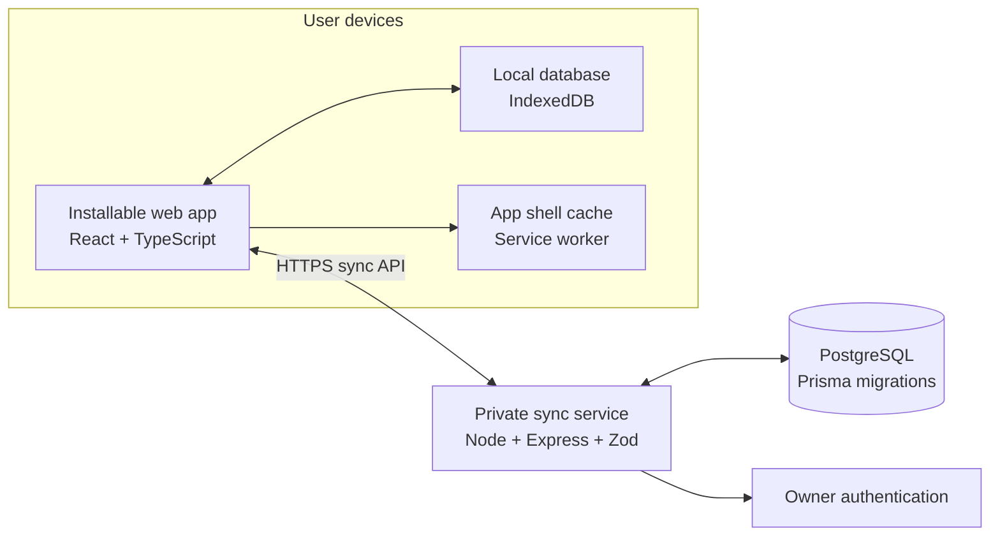

# Architecture Proposal

## Goals

Support offline daily use on Windows 11 and Android, keep iPhone installability feasible, synchronize a single owner's devices privately, and preserve trustworthy history. Keep the first implementation understandable and recoverable.

## Proposed shape

The installable web app/PWA is the leading cross-platform option because it could share one interface across Windows, Android, and iPhone while storing local data. Its offline, installation, background-sync, and notification behavior must be verified on the target browsers/devices before locking it in. If a critical requirement fails on iPhone, document a native-wrapper alternative before Stage 1.

## Main components

- **Client app:** React, TypeScript, Vite, accessible UI, semantic CSS tokens, i18n. English default; Persian RTL; theme and date display preferences.
- **Local persistence:** IndexedDB through a small typed repository layer (Dexie is a candidate). UI reads and writes locally first so ordinary workflows do not wait for network.
- **Offline assets:** service worker caches the versioned application shell. Updating the app must not erase local records.
- **Sync client:** durable local outbox with client-generated UUIDs, idempotency keys, per-record revisions, tombstones, retry/backoff, and visible sync status.
- **Private sync API:** Node.js/Express with Zod validation. Authenticated owner ID comes from server session/token, never from request payload.
- **Server database:** PostgreSQL with Prisma migrations. Server validates links and ownership, assigns canonical revision/snapshots, and stores change history needed for sync and recovery.
- **Shared packages:** shared schemas/types and a separate date/time package for timezone-safe local-date, week-boundary, recurrence, and Gregorian/Jalali display behavior.
- **Deployment:** private HTTPS endpoint with managed PostgreSQL is the initial recommendation for low maintenance. Provider, region, operating cost, and end-to-end encryption decision remain open.

## Local-first and synchronization model

1. Every ordinary create/edit operation is first saved to the local database and shown immediately.
2. A queued operation is sent when online. Every operation has a stable UUID/idempotency key so retries do not duplicate data.
3. The server authenticates the owner, validates all IDs and relationships, applies changes transactionally, assigns the canonical revision, and returns accepted revisions and any conflicts.
4. The client pulls changes after its last server cursor and applies them locally. Tombstones are retained long enough for offline devices to learn about deletions.
5. If two devices edit the same mutable definition from the same base revision, the server returns a conflict. The UI shows the two values and asks the owner to choose or combine them. It does not silently discard a change.
6. Historical records are immutable events. Corrections create an auditable correction record. A locally recorded session carries references to the task/project/workstream revisions it observed; sync operations are ordered so the server can validate relationships and create canonical snapshots.
7. The sync API is not the only recovery path: export and backup/restore must work independently of device sync.

## Data flow boundaries

- The client may calculate provisional progress for responsive UI, but authoritative goal and dashboard calculations use shared, documented domain logic and are checked against server aggregates.
- Server is authoritative for user identity, ownership, canonical snapshots, sync revisions, correction audit, and conflict resolution.
- Calendar blocks represent planned occurrences. Execution sessions represent actual work. Neither is a substitute for the other.
- All instants are stored as UTC timestamps; date-only concepts use local date keys and explicit timezone context. Jalali is a display/calendar option, not an implicit timezone or arithmetic mode.

## Security and privacy outline

- HTTPS in transit; secure credential/session storage; server-side authorization on every query/mutation.
- Private service account for the owner and an explicit device enrollment/revocation flow.
- Secrets stored in environment configuration and excluded from Git.
- Server database backups and user-controlled export/restore.
- Encryption-at-rest and whether end-to-end encryption is required are open decisions. Do not promise end-to-end encryption unless the design and recovery model support it.

## Technology candidates

The proposed stack adapts the initial direction: TypeScript monorepo/npm workspaces; React/Vite; Express/Zod; PostgreSQL/Prisma; Docker Compose for local server development; Vitest/RTL, PostgreSQL integration tests, and Playwright. Candidate client libraries include TanStack Query for remote sync state, FullCalendar for planning, Recharts for metrics, and i18next for translation. Verify current versions, licensing, accessibility, offline fit, and platform support during Stage 1 selection.
