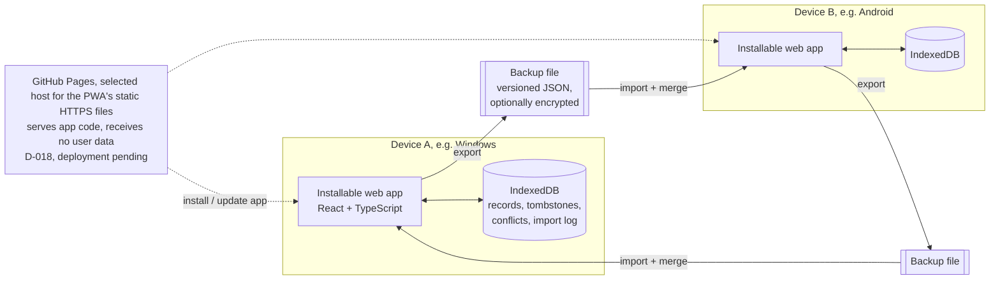
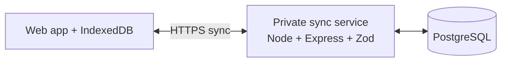

# Architecture

## Goals

Support offline daily use on Windows 11 and Android, keep iPhone installability feasible, and preserve trustworthy history. **Version 1** is an installable PWA (D-013) that keeps data only on each device and moves it between devices with a merged backup file (DECISIONS D-008 to D-017). Automatic sync between a single owner's devices is a later, optional addition. Keep the implementation understandable and recoverable.

## Version 1 shape

User data never leaves a device except in a backup file the user exports.

**What still needs internet in v1.** Daily use after installation works offline. Installing the app the first time and receiving app updates need internet: v1 is an installable PWA (D-013), so the app files are downloaded from a web address (HTTPS is required for the service worker and for installation on Android and iPhone), and updates are fetched from the same address when the device is online. Native wrappers are not part of v1. GitHub Pages is the selected host (D-018), with the proposed stable URL `https://moeintorabi90.github.io/personal-productivity-system/`. **Deployment is pending:** the workflow is prepared on branch `feat/github-pages-deploy`, which is not merged into `main`; Pages has not been configured in the repository settings, and the workflow has never run, so the app is not online at that URL yet. Reachability from the owner's region and installation on real devices are **not yet verified**.

**Hosting on GitHub Pages (D-018; prepared, not yet deployed).** Once the branch is merged and Pages is set to deploy from GitHub Actions, the workflow (`.github/workflows/deploy-pages.yml`) is intended to run on every push to `main` (and manually): `npm ci`, typecheck, the Vitest suite, and the production build; then it publishes only `apps/web/dist` to Pages. It has not run yet, including on its Ubuntu runner. Nothing else would be deployed: no API, sync service, database, accounts, or secrets, and the frozen sync UI stays off (`VITE_ENABLE_FROZEN_SYNC` is not set). The site is a GitHub **project site**, so the app lives under the path `/personal-productivity-system/`: production builds use that Vite `base` (`APP_BASE_PATH` in `apps/web/vite.config.ts`; the dev server stays at `/`), the service worker is registered at `<base>sw.js` with scope `<base>`, and the manifest's `id`, `start_url`, and `scope` (relative `./`) and icons resolve inside that path. The E2E tests serve the build under the same path and fail on any request outside it. The path is part of the installed app's identity (manifest `id`, service-worker scope), so it must not change once the app is in use; renaming the repository changes it.

**Local data is tied to the app's origin.** Browsers store IndexedDB and the service-worker cache per **origin**: the combination of scheme, host, and port (e.g. `https://app.example.org:443`). The path does not matter, so `…/index.html` and `…/settings` share data, but `http://` vs `https://`, a different host or subdomain, or a different port is a separate origin with separate, empty storage. Changing the origin later makes existing local data invisible to the new one; a backup export/import is the migration path. The origin should therefore be chosen once and kept stable.

**Trust in whoever serves the app code.** A static host never receives user data from the app, but it delivers the code that runs with full access to that origin's local data. If code served from that origin is malicious or tampered with (a compromised hosting account, a modified build, a hijacked domain), it can technically read, change, or send the local data. Mitigations to weigh with the hosting decision: HTTPS only; strong protection (2FA) of the hosting and domain accounts; reproducible builds from this repository; no third-party scripts and a strict Content-Security-Policy; showing the app version and applying updates visibly. The selected host is GitHub Pages (D-018; deployment pending); the code is to be built from this public repository by its workflow, so the GitHub account (2FA), the repository, and its Actions configuration are what must be protected. **Shared origin:** all GitHub Pages sites of one account share the origin `https://moeintorabi90.github.io`, and local data is per origin, not per path. Any other Pages site published from the same account (another project repository, or a `moeintorabi90.github.io` user site) would run with full access to this app's local data. Therefore no other Pages site should be published from that account unless its code is equally trusted; moving to a custom domain later would be a new origin (data moves by backup export/import). GitHub Pages does not let a site set a Content-Security-Policy header (only a `<meta>` CSP is possible), which is a known limitation. Reachability from the owner's region has not been verified.

### Platform installation, updates, and storage (v1, D-013)

The statements below describe documented or commonly observed browser behavior. Items marked **(verify)** have not been checked on a real device for this app yet; the device checks in ROADMAP Stage 1/1B confirm or correct them. Browser behavior changes between versions, so record the device, OS, and browser version with every check.

**All platforms**

- **Install** needs internet and the app's HTTPS URL, `https://moeintorabi90.github.io/personal-productivity-system/` (D-018). That site is not deployed yet, so nothing can be installed from it until the first deployment succeeds. During development, `localhost` is the only exception.
- **Updates** need internet. When the installed app is opened online, the browser checks for a new service worker; the v1 service worker installs the new version in the background and activates it immediately, but the open window keeps running the old code until the app is reloaded or relaunched. Offline, the last installed version keeps working indefinitely. Updates never touch local data; data-format changes run as tested local migrations.
- **Storage scope:** local data belongs to one browser (or browser profile) **and** one origin. Another browser, another browser profile, or (on iPhone) Safari tabs versus the Home Screen app have separate, independent storage.
- **Losing data:** uninstalling the app with its data, clearing site or browser data, resetting the device, or browser eviction under storage pressure deletes local data. **Only exported backup files protect against this.**
- **Persistent storage:** the app asks the browser to mark its storage as persistent (`navigator.storage.persist()`); the browser decides whether to grant it, and granting reduces but does not eliminate eviction risk. The "last backup" indicator (Stage 1B) is the user's main signal.

**Windows 11 — Microsoft Edge**

- Install from Edge ("Install this site as an app" from the address bar or the Apps menu). The app gets its own window and a Start menu entry.
- Data lives in the Edge profile used for installing; another Edge profile or another browser starts empty.
- Chromium-based browsers allow a large storage quota (a share of free disk space). Eviction under disk pressure is possible for non-persistent storage; whether Edge grants persistent storage to the installed app **(verify)**.
- Uninstalling offers to clear the app's data as well; choosing it deletes local data.
- Verified so far (automated, headless Edge 155): offline reload of the installed shell, data surviving a browser restart and an offline reopen. The install UI itself has not been tested.

**Android — compatible browser**

- Targets are Chromium-based browsers (Chrome; Edge and Samsung Internet are expected to behave similarly **(verify)**). Other browsers may only offer a home-screen shortcut with different offline/storage behavior and are not targets until verified.
- Install from the browser menu ("Install app" / "Add to Home screen"). Chrome creates a WebAPK that looks like a normal app.
- Data lives inside the browser that installed the app. Installing from Chrome but opening the site in another browser shows empty, separate storage. Clearing that browser's storage in Android settings deletes the app's data.
- Eviction under low storage is possible unless persistent storage is granted **(verify)**; app name/icon changes may take a while to reach an installed WebAPK.
- Backup export via the share sheet or a download; import via the system file picker **(verify)**.

**iPhone — Safari**

- Install only via Safari → Share → **Add to Home Screen**; iOS shows no automatic install prompt, so the app should show a short instruction.
- The Home Screen app has **its own storage, separate from Safari tabs**: data entered in a Safari tab is not visible in the installed app and vice versa. Users should use only the installed app.
- **Storage retention:** in Safari, WebKit deletes script-writable storage (including IndexedDB) of websites the user has not interacted with during seven days of browser use. According to WebKit, this seven-day deletion **does not apply to web apps added to the Home Screen**. That does **not** make the data permanent: it is still deleted when the user removes the Home Screen app or clears website data, and it may still be evicted when the device is under storage pressure. **Long-term retention is not guaranteed** **(verify the current behavior on a real device with the target iOS version)**. Regular backups are essential on iPhone.
- Deleting the Home Screen app deletes its data.
- Updates are fetched when the app is opened online; iOS may keep a suspended app on its old code until it is fully closed and reopened.
- No background sync (not needed in v1). Notifications are only possible for Home Screen apps on newer iOS versions and are not part of v1.
- Backup export via the share sheet (save to Files) and import via the Files picker; selecting `.json` files **(verify)**. Storage quotas differ by iOS version **(verify)**.
- The minimum supported iOS version is to be set after device testing.

### After v1 (not built now)

The Stage 1 sync API, authentication, PostgreSQL schema, and client sync engine stay in the repository but are **frozen and inactive** in v1 (D-016): no sync service is developed or run. A future sync would exchange the same record envelopes as backups (T-016); the frozen code would be reviewed first and may need changes.

The installable PWA is the v1 delivery method (D-013) because it shares one interface across Windows, Android, and iPhone while storing local data. Its offline and installation behavior, and file import/export on each platform, must still be verified on real devices. If a critical requirement fails on a platform, report it to the owner; a native wrapper would be a new product decision.

## Main components

- **Client app:** React, TypeScript, Vite, accessible UI, semantic CSS tokens, i18n. English default; Persian RTL; theme and date display preferences.
- **Local persistence:** IndexedDB through a small typed repository layer (Dexie). It is the only data store in v1. Every record uses the envelope of T-016 (UUID, timestamps, version vector, content hash); deletions keep tombstones. The repository layer, not the UI, enforces domain rules (relationships, history immutability), so the same rules apply to typed-in and imported data.
- **Backup module (v1):** export, validation, versioned upgrade chain, import preview, atomic merge, pending conflicts, replaced-version archive, and import log, as specified in `BACKUP_FORMAT.md`. Optional per-export password encryption via Web Crypto (AES-GCM, PBKDF2), off by default (D-014).
- **Offline assets:** service worker caches the versioned application shell. Updating the app must not erase local records; local data schema upgrades run in IndexedDB version upgrades and are tested like backup upgrades.
- **Shared packages:** shared schemas/types (also the backup schemas) and a separate date/time package for timezone-safe local-date, week-boundary, recurrence, and Gregorian/Jalali display behavior.
- **App delivery (v1):** installable PWA (D-013), to be served as static files over HTTPS from GitHub Pages (D-018; deployment pending). No user data on any server; the app code's source must be trusted (see above).
- **After v1 only:** sync client (outbox), private sync API (Express/Zod), PostgreSQL. Built in Stage 1; frozen and inactive in v1 (D-016).

## Local-first model and backup merge (v1)

1. Every create/edit is saved to the local database and shown immediately. Each local edit increments this device's counter in the record's version vector.
2. Export writes all records and tombstones into one versioned file.
3. Import validates the whole file first, then previews: new, already here, older copy, newer in backup, conflict, deleted here/in backup. Only new items are added automatically; everything else that would change existing data needs the user's explicit choice. Applying is one atomic transaction (`BACKUP_FORMAT.md`).
4. Conflicts keep both versions until resolved; the replaced version is archived for undo.
5. Historical records are immutable events; corrections are separate records, so merging history is append-only.

## Synchronization model (after v1, reference for the frozen Stage 1 code)

1. Every ordinary create/edit operation is first saved to the local database and shown immediately.
2. A queued operation is sent when online. Every operation has a stable UUID/idempotency key so retries do not duplicate data.
3. The server authenticates the owner, validates all IDs and relationships, applies changes transactionally, assigns the canonical revision, and returns accepted revisions and any conflicts.
4. The client pulls changes after its last server cursor and applies them locally. Tombstones are retained long enough for offline devices to learn about deletions.
5. If two devices edit the same mutable definition from the same base revision, the server returns a conflict. The UI shows the two values and asks the owner to choose or combine them. It does not silently discard a change.
6. Historical records are immutable events. Corrections create an auditable correction record. A locally recorded session carries references to the task/project/workstream revisions it observed; sync operations are ordered so the server can validate relationships and create canonical snapshots.
7. The sync API is not the only recovery path: export and backup/restore must work independently of device sync.

## Data flow boundaries

- In v1 the device's domain layer is authoritative: goal and dashboard calculations use shared, documented domain logic, and the same validation applies to imported records. (With a future sync service, the server would become authoritative for identity, ownership, and canonical revisions.)
- Snapshots that must not change (session/block snapshots, finalized reviews) are captured locally at the time of the event and travel unchanged in backups.
- Calendar blocks represent planned occurrences. Execution sessions represent actual work. Neither is a substitute for the other.
- All instants are stored as UTC timestamps; date-only concepts use local date keys and explicit timezone context. Jalali is a display/calendar option, not an implicit timezone or arithmetic mode.

## Security and privacy outline

**Version 1:**

- User data stays on the device; there is no network traffic carrying user data. The app host (if used) only serves app files, but the code it serves can access the origin's local data, so the host, domain, and build pipeline are part of the trust boundary.
- Data at rest in IndexedDB is protected by the device's lock and storage encryption; the app does not add its own encryption in v1.
- A backup file contains all personal data. Password encryption is optional per export and off by default (D-014); an unprotected file is readable by anyone who gets it, and a forgotten password makes a protected file impossible to restore (`BACKUP_FORMAT.md`). A recovery key is not part of v1.
- Imported files are untrusted input: size limits, full schema validation, reference checks, and no execution of anything from the file; text from files is rendered as text only.
- A strict Content-Security-Policy on the app host, and no third-party scripts.

**After v1 (sync service):**

- HTTPS in transit; secure credential/session storage; server-side authorization on every query/mutation.
- Private service account for the owner and an explicit device enrollment/revocation flow.
- Secrets stored in environment configuration and excluded from Git.
- Encryption-at-rest and whether end-to-end encryption is required are open decisions. Do not promise end-to-end encryption unless the design and recovery model support it.

Known limitations of the frozen Stage 1 server code, to address before it is ever used with real data:

- The bearer token is stored in IndexedDB, so any script injected into the page could read it. A strict Content-Security-Policy (set by the hosting layer) and avoiding third-party scripts are required; HttpOnly cookies are an alternative to evaluate with the hosting choice.
- The failed-login limiter is in memory (one process) and keys on `req.ip`; behind a reverse proxy, `trust proxy` must be configured or all clients share one key.
- No CORS headers are sent: the web app and API are expected to share an origin (Vite proxies `/v1` in development).
- `SETUP_TOKEN` is optional only while the API listens on loopback (the default, T-015); production and any non-loopback `HOST` refuse to start without it. Without a token, any program on the same computer can still complete first-run setup until it is done.
- No account recovery flow exists yet (open decision 3).

## Stage 1 implementation notes

- **Client:** React 19 + Vite 8, Dexie 4 over IndexedDB, typed in-house i18n (T-009), CSS tokens for light/dark/system themes and logical properties for RTL. A hand-written service worker precaches the versioned shell and never caches `/v1` API responses (T-008). Before sign-in the app works fully on the device and queues nothing for preferences; diagnostic notes queue and sync after sign-in.
- **Sync API:** Express 5 + Zod 4 on Node 24, run as TypeScript through Node's type stripping. Data access is plain SQL behind a two-method `Db` interface implemented by PGlite (dev/test) and `pg` (PostgreSQL) (T-006, T-007).
- **Repository layout:** one root `package.json` with path aliases because the drive is exFAT (T-014).

## Stage 1B implementation notes

- **Backup module** (`apps/web/src/backup/`): `limits.ts` (format-version-1 limits), `scan.ts` (constant-memory pre-parse scan), `jcs.ts`, `sha256.ts` (synchronous, for content hashes inside IndexedDB transactions; Web Crypto for file integrity), `format.ts` (strict header/encryption/payload schemas), `read.ts` (validation order steps 1–8), `crypto.ts` (PBKDF2/AES-GCM via Web Crypto), `merge.ts` (preview and one-transaction apply), `conflicts.ts` (resolutions, bulk, undo), `export.ts` (export with re-open verification), `deliver.ts` (download / share sheet), `registry.ts` (record types allowed in product backups: `preferences` only for now).
- **Local data:** IndexedDB schema version 2 with `records`, `tombstones`, `pendingConflicts`, `replacedVersions`, `importLog` (DATA_MODEL); `local/records.ts` for local edits (version-vector bump, tombstones), `local/settings.ts` for shared preferences.
- **UI:** Backup screen (export with optional password, import with preview, conflicts, undo), last-backup indicator in the header, install guide on Home.
- **Frozen sync code (D-016):** hidden and never started unless the development build flag `VITE_ENABLE_FROZEN_SYNC=true` is set; the code itself was not changed.

### Platform feasibility (Stage 1 findings)

| Platform | Status |
|---|---|
| Windows 11, Microsoft Edge 155 | Verified by automated E2E: offline reload of the installed shell, data surviving a browser restart and an offline reopen, RTL/theme persistence. Install UI itself not exercised by tests. |
| Android (Chrome) | Not yet tested on a device. Manifest has 192/512 PNG and maskable icons, which Chrome requires for installation. Items to verify: see "Platform installation, updates, and storage". |
| iPhone (Safari) | Not yet tested on a device. `apple-touch-icon` and standalone meta tags are present. Items to verify: see "Platform installation, updates, and storage". |

## Technology stack

### Adopted (current)

| Area | Choice | Decision |
|---|---|---|
| Repository | Monorepo folder layout (`apps/web`, `apps/api`, `packages/shared`) with **one root `package.json`** and path aliases; no npm workspaces (exFAT drive) | T-014 |
| Language/tooling | TypeScript 7, Node.js 24 (built-in type stripping for the API) | Stage 1 |
| Client | React 19 + Vite 8; Dexie 4 over IndexedDB; typed in-house i18n (no i18next); hand-written service worker (no `vite-plugin-pwa`) | T-008, T-009 |
| Shared validation | Zod 4 schemas in `packages/shared` | Stage 1 |
| Tests | Vitest (unit, repository, component with React Testing Library + jsdom), Playwright with the installed Microsoft Edge | T-013 |
| v1 backup (Stage 1B) | Web Crypto (PBKDF2, AES-GCM, SHA-256 for file integrity), in-house synchronous SHA-256 for content hashes, JCS canonical JSON, constant-memory pre-parse scan | T-016–T-018 |
| Frozen post-v1 server (inactive in v1) | Express 5 + Zod; plain SQL with the `pg` driver (no Prisma); PGlite for development/tests | T-006, T-007, T-019, D-016 |
| App delivery | Installable PWA (Edge on Windows, compatible browser on Android, Safari on iPhone); static hosting selected: GitHub Pages under `/personal-productivity-system/`, to be deployed from `main` by GitHub Actions (workflow prepared; not yet deployed) | D-013, D-018 |

Not used: Docker (T-005), Prisma (T-006), npm workspaces (T-014), i18next (T-009), `vite-plugin-pwa` (T-008).

### Candidates for later stages (not yet selected)

FullCalendar or a lighter calendar component for planning (Stage 3), a charting library such as Recharts for metrics (Stage 6), and a Jalali date utility for the date/time package. Verify current versions, licensing, bundle size, accessibility, RTL support, and offline fit when each stage starts. TanStack Query is no longer relevant to v1 (no remote data).

### History (Stage 0 proposal, superseded)

The Stage 0 proposal named a TypeScript monorepo with npm workspaces; React/Vite; Express/Zod; PostgreSQL with Prisma; Vitest/RTL, PostgreSQL integration tests, and Playwright; optional Docker Compose; and TanStack Query, FullCalendar, Recharts, and i18next as client candidates. It was replaced by the decisions above during Stage 1 and by the v1 re-scope (D-012).
