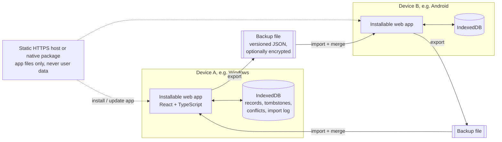
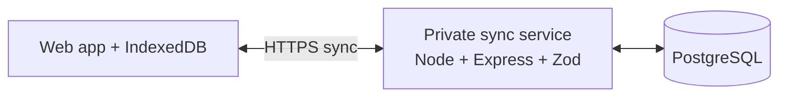

# Architecture Proposal

## Goals

Support offline daily use on Windows 11 and Android, keep iPhone installability feasible, and preserve trustworthy history. **Version 1** keeps data only on each device and moves it between devices with a merged backup file (DECISIONS D-008 to D-012). Automatic sync between a single owner's devices is a later, optional addition. Keep the implementation understandable and recoverable.

## Version 1 shape

User data never leaves a device except in a backup file the user exports. The app files themselves must still be delivered once (DECISIONS open question 8): a PWA needs an HTTPS address to install on Android/iPhone, and its local data belongs to that address, so the address must be chosen once and kept stable.

### After v1 (not built now)

The Stage 1 sync API, authentication, PostgreSQL schema, and client sync engine exist and are tested, but are frozen and not part of v1 (T-019). A future sync would exchange the same record envelopes as backups (T-016).

The installable web app/PWA is the leading cross-platform option because it can share one interface across Windows, Android, and iPhone while storing local data. Its offline and installation behavior, and file import/export on each platform, must be verified on real devices. If a critical requirement fails on iPhone, document a native-wrapper alternative.

## Main components

- **Client app:** React, TypeScript, Vite, accessible UI, semantic CSS tokens, i18n. English default; Persian RTL; theme and date display preferences.
- **Local persistence:** IndexedDB through a small typed repository layer (Dexie). It is the only data store in v1. Every record uses the envelope of T-016 (UUID, timestamps, version vector, content hash); deletions keep tombstones. The repository layer, not the UI, enforces domain rules (relationships, history immutability), so the same rules apply to typed-in and imported data.
- **Backup module (v1):** export, validation, versioned upgrade chain, import preview, atomic merge, pending conflicts, replaced-version archive, and import log, as specified in `BACKUP_FORMAT.md`. Optional encryption via Web Crypto (AES-GCM, PBKDF2) if the owner chooses it.
- **Offline assets:** service worker caches the versioned application shell. Updating the app must not erase local records; local data schema upgrades run in IndexedDB version upgrades and are tested like backup upgrades.
- **Shared packages:** shared schemas/types (also the backup schemas) and a separate date/time package for timezone-safe local-date, week-boundary, recurrence, and Gregorian/Jalali display behavior.
- **App delivery (v1):** static HTTPS hosting of the app files only, or a native wrapper (open question 8). No user data on any server.
- **After v1 only:** sync client (outbox), private sync API (Express/Zod), PostgreSQL. Built in Stage 1, frozen (T-019).

## Local-first model and backup merge (v1)

1. Every create/edit is saved to the local database and shown immediately. Each local edit increments this device's counter in the record's version vector.
2. Export writes all records and tombstones into one versioned file.
3. Import validates the whole file first, then previews: new, already here, older copy, newer in backup, conflict, deleted here/in backup. Only new items are added automatically; everything else that would change existing data needs the user's explicit choice. Applying is one atomic transaction (`BACKUP_FORMAT.md`).
4. Conflicts keep both versions until resolved; the replaced version is archived for undo.
5. Historical records are immutable events; corrections are separate records, so merging history is append-only.

## Synchronization model (after v1, reference for the frozen Stage 1 code)

1. Every ordinary create/edit operation is first saved to the local database and shown immediately.
2. A queued operation is sent when online. Every operation has a stable UUID/idempotency key so retries do not duplicate data.
3. The server authenticates the owner, validates all IDs and relationships, applies changes transactionally, assigns the canonical revision, and returns accepted revisions and any conflicts.
4. The client pulls changes after its last server cursor and applies them locally. Tombstones are retained long enough for offline devices to learn about deletions.
5. If two devices edit the same mutable definition from the same base revision, the server returns a conflict. The UI shows the two values and asks the owner to choose or combine them. It does not silently discard a change.
6. Historical records are immutable events. Corrections create an auditable correction record. A locally recorded session carries references to the task/project/workstream revisions it observed; sync operations are ordered so the server can validate relationships and create canonical snapshots.
7. The sync API is not the only recovery path: export and backup/restore must work independently of device sync.

## Data flow boundaries

- In v1 the device's domain layer is authoritative: goal and dashboard calculations use shared, documented domain logic, and the same validation applies to imported records. (With a future sync service, the server would become authoritative for identity, ownership, and canonical revisions.)
- Snapshots that must not change (session/block snapshots, finalized reviews) are captured locally at the time of the event and travel unchanged in backups.
- Calendar blocks represent planned occurrences. Execution sessions represent actual work. Neither is a substitute for the other.
- All instants are stored as UTC timestamps; date-only concepts use local date keys and explicit timezone context. Jalali is a display/calendar option, not an implicit timezone or arithmetic mode.

## Security and privacy outline

**Version 1:**

- User data stays on the device; there is no network traffic carrying user data. The static app host (if used) only serves app files.
- Data at rest in IndexedDB is protected by the device's lock and storage encryption; the app does not add its own encryption in v1.
- A backup file contains all personal data. Its protection (optional password encryption, recovery key, or none) is an open owner decision; options and the forgotten-password consequence are in `BACKUP_FORMAT.md`.
- Imported files are untrusted input: size limits, full schema validation, reference checks, and no execution of anything from the file; text from files is rendered as text only.
- A strict Content-Security-Policy on the app host, and no third-party scripts.

**After v1 (sync service):**

- HTTPS in transit; secure credential/session storage; server-side authorization on every query/mutation.
- Private service account for the owner and an explicit device enrollment/revocation flow.
- Secrets stored in environment configuration and excluded from Git.
- Encryption-at-rest and whether end-to-end encryption is required are open decisions. Do not promise end-to-end encryption unless the design and recovery model support it.

Known limitations of the frozen Stage 1 server code, to address before it is ever used with real data:

- The bearer token is stored in IndexedDB, so any script injected into the page could read it. A strict Content-Security-Policy (set by the hosting layer) and avoiding third-party scripts are required; HttpOnly cookies are an alternative to evaluate with the hosting choice.
- The failed-login limiter is in memory (one process) and keys on `req.ip`; behind a reverse proxy, `trust proxy` must be configured or all clients share one key.
- No CORS headers are sent: the web app and API are expected to share an origin (Vite proxies `/v1` in development).
- `SETUP_TOKEN` is optional only while the API listens on loopback (the default, T-015); production and any non-loopback `HOST` refuse to start without it. Without a token, any program on the same computer can still complete first-run setup until it is done.
- No account recovery flow exists yet (open decision 3).

## Stage 1 implementation notes

- **Client:** React 19 + Vite 8, Dexie 4 over IndexedDB, typed in-house i18n (T-009), CSS tokens for light/dark/system themes and logical properties for RTL. A hand-written service worker precaches the versioned shell and never caches `/v1` API responses (T-008). Before sign-in the app works fully on the device and queues nothing for preferences; diagnostic notes queue and sync after sign-in.
- **Sync API:** Express 5 + Zod 4 on Node 24, run as TypeScript through Node's type stripping. Data access is plain SQL behind a two-method `Db` interface implemented by PGlite (dev/test) and `pg` (PostgreSQL) (T-006, T-007).
- **Repository layout:** one root `package.json` with path aliases because the drive is exFAT (T-014).

### Platform feasibility (Stage 1 findings)

| Platform | Status |
|---|---|
| Windows 11, Microsoft Edge 155 | Verified by automated E2E: offline reload of the installed shell, data surviving a browser restart and an offline reopen, RTL/theme persistence. Install UI itself not exercised by tests. |
| Android (Chrome) | Not yet tested on a device. Manifest has 192/512 PNG and maskable icons, which Chrome requires for installation. To verify for v1: file export via share sheet/download and import via file picker. |
| iPhone (Safari) | Not yet tested on a device. `apple-touch-icon` and standalone meta tags are present. Known platform limits to verify: storage eviction of web apps not added to the Home Screen (backups therefore matter more), share sheet export and Files import of `.json`, no background sync, notification support only for Home Screen web apps. |

## Technology candidates

The proposed stack adapts the initial direction: TypeScript monorepo/npm workspaces; React/Vite; Express/Zod; PostgreSQL/Prisma; Vitest/RTL, PostgreSQL integration tests, and Playwright. Docker Compose is optional, not a prerequisite: this PC is at Docker Desktop's published minimum RAM and has little free memory, so first evaluate native PostgreSQL on the larger E: drive or a managed development database. Candidate client libraries include TanStack Query for remote sync state, FullCalendar for planning, Recharts for metrics, and i18next for translation. Verify current versions, licensing, accessibility, offline fit, and platform support during Stage 1 selection.
