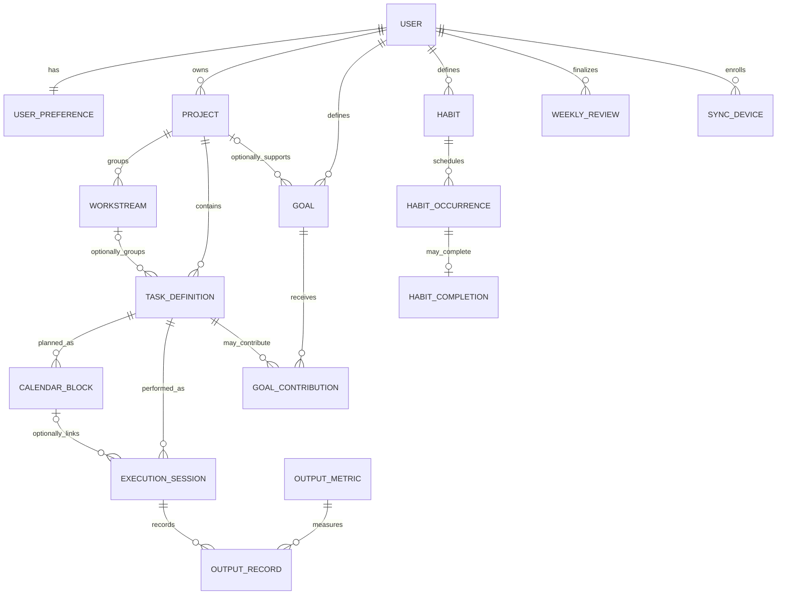

# Data Model and Invariants

## Relationship sketch

Names in the diagram are conceptual. Tables are defined by plain SQL migrations in `apps/api/migrations` (DECISIONS T-006); later stages add their own migrations.

## Implemented in Stage 1 server (`0001_foundation.sql`) — frozen, not part of v1

| Table | Purpose and key constraints |
|---|---|
| `app_user` | Owner account; unique `lower(email)`; scrypt password hash |
| `app_installation` | Singleton row (`CHECK (singleton)`) naming the one owner, which makes setup race-free |
| `sync_device` | Client-generated device IDs, unique per owner (`PRIMARY KEY (user_id, id)`); `revoked_at` |
| `auth_session` | SHA-256 token hash, expiry, revocation; FK to the owner's device |
| `user_preference` | Language, theme, calendar display, week start, nullable IANA time zone, `revision`; CHECK constraints mirror the shared Zod schema |
| `sync_probe` | Stage 1 sync diagnostic record (T-011), not product data and not in v1 backups; `PRIMARY KEY (user_id, id)`; tombstone via `deleted_at` |
| `sync_operation` | Applied push results by `(user_id, op_id)` with request hash, for idempotent retries |
| `change_log` | Append-only per-owner change stream (`seq` identity) read by pull; deletions are `deleted = true` rows |
| `schema_migrations` | Applied migration versions and checksums (created by the runner) |

Foreign keys use `ON DELETE RESTRICT`: nothing referenced by history is removed by cascade.

## On the device (IndexedDB, `apps/web/src/local/db.ts`, schema version 2 since Stage 1B)

| Table | Contents | In backups |
|---|---|---|
| `records` | Product records as envelopes, primary key `[type+id]`: shared preferences under its reserved ID; since Stage 2 `projects`, `workstreams`, and `taskDefinitions`; since Stage 3 `calendarBlocks` (no IndexedDB schema change was needed) | Yes |
| `tombstones` | Deletion markers `[type+id]` with version vector | Yes |
| `pendingConflicts` | Undecided import conflicts with both versions (D-015) | Yes |
| `replacedVersions` | Versions replaced by a choice or a confirmed update (undo) | Yes |
| `importLog` | One row per import: backup ID, source device, counts | No |
| `meta` | Device identity (ID, name), `deviceSettings` (language, theme; D-017), `lastBackupAt`; frozen sync: session, cursor, last sync | Device settings only as informational `sourceDeviceSettings` |
| `preferences` (legacy `"self"` row), `probes` (`sync_probe`), `outbox`, `conflicts` | Frozen post-v1 sync code (D-016). The v2 migration copies `"self"` into shared preferences and device settings and leaves it unchanged; v1 never reads it again | Never |

## Entities

- **User:** in v1 there is no account; "the owner" is whoever uses the device. (A future sync service would add an owner account.)
- **Device:** local identity of each installation (UUID and editable name). Used in version vectors and to label backups; never sent anywhere in v1.
- **UserPreference:** shared, transferable settings (explicit IANA time zone, week start, calendar display, later capacity preferences) as one singleton record with a reserved ID; plus device-local settings (language, theme) that stay on each device (decided split, D-017; `BACKUP_FORMAT.md`).
- **Project / Workstream:** user-created organization. A workstream belongs to one project and is not nestable.
- **TaskDefinition:** reusable task details (and, from Stage 3, recurrence configuration). It is not evidence that work occurred.

### Stage 2 record types (implemented; `dataSchemaVersion` 2)

| Type | Data fields | Links | Rules |
|---|---|---|---|
| `projects` | `name` (1–200 characters, not blank), `description` (≤ 20,000), `archivedAt` (UTC instant or null) | — | — |
| `workstreams` | `projectId`, `name`, `description`, `archivedAt` | `projectId` → `projects` | `projectId` never changes (DECISIONS T-022) |
| `taskDefinitions` | `title` (1–200, not blank), `notes` (≤ 20,000), `projectId` (or null), `workstreamId` (or null), `nextAction` (≤ 500), `estimateMinutes` (whole minutes 1–10,080, or null), `archivedAt` | `projectId` → `projects`, `workstreamId` → `workstreams` | a workstream requires a project, and must belong to that project |

- **Inbox:** task definitions with `projectId` null (DECISIONS T-021). Organizing a captured item edits the same record; nothing is copied.
- **Archive** is data (`archivedAt`), not a deletion; archiving never changes linked records (T-023). Stage 2 offers no delete; deleting a record that live records link to is refused (restrict).
- `notes` is the task's descriptive text; there is no separate description field (owner-approved, T-024).
- **Deferred in Stage 2** (owner-approved, T-024): recurrence and active weekdays (added in Stage 3 as the optional `recurrence` field, below in "Stage 3 record types and fields"), relevant output metrics (Stage 5), and a task type (only after the owner defines a use case and categories). Each is added with a new `dataSchemaVersion` and an upgrade step.
- All three types are **linked** (they link to, or are linked from, another type), so a conflict on any of them offers "keep this device's" or "use the backup's" version, never "keep both".
- **OutputMetric:** named unit and formatting/aggregation rules (e.g. pages, words, applications). Metric definitions have revisions so historical outputs retain their meaning.
- **Goal / Milestone / GoalContribution:** a measurable outcome, optional project link, target/window/status and explicit attribution rules; a goal may contain milestones, which cannot exist independently. The owner manually marks milestone completion. Progress is derived from sessions, task completion events, and output records.
- **CalendarBlock:** planned occurrence with planned start/end, local-date key, timezone, source recurrence, relationship IDs, and task/project/workstream snapshot/revision. Implemented in Stage 3 as record type `calendarBlocks` (below).
- **ExecutionSession:** actual work event, planned or unplanned, with task ID, optional block ID, actual timestamps, state, context, notes, and canonical snapshots.
- **OutputRecord:** actual value for a metric and session. Corrections append an audit event rather than replacing the original value.
- **Habit / HabitOccurrence / HabitCompletion:** user-defined recurring activity, planned local-date occurrence, and separate completion record.
- **WeeklyReview:** selected local week, computed immutable summary snapshot, source record IDs/revisions, user observations, and next-week adjustments.
- **Tombstone:** deletion marker (record type, ID, deletion time, version vector) kept locally and exported in backups.
- **PendingConflict / ReplacedVersion / ImportLog (v1, local only):** both versions of an unresolved import conflict; versions replaced by a user's choice (for undo); and the record of each import (backup ID, source device, counts). See `BACKUP_FORMAT.md`.
- **SyncDevice / ChangeLog (after v1, server):** enrolled device cursor and accepted change stream; implemented in the frozen Stage 1 code.

### Stage 3 record types and fields (implemented and merged into `main`; `dataSchemaVersion` 3)

Contract: PRODUCT_SPEC "Stage 3 planning contract"; decisions D-019 to D-023, T-025 to T-036 in DECISIONS. The behavior behind each field is owner-approved (D-022, D-023, T-029 to T-036, 2026-10-24); field names and value encodings below are technical implementation choices serving that behavior.

Common value formats: **local date** = ISO Gregorian `YYYY-MM-DD` (a real calendar date); **instant** = UTC ISO-8601 timestamp; **weekday** = integer 0 (Sunday) … 6 (Saturday), the same numbering as `weekStart`; **zone** = valid IANA time zone name.

| Type / field | Shape | Rules |
|---|---|---|
| `taskDefinitions.recurrence` (new, optional) | absent = not recurring; otherwise `{ kind: "weekdays", weekdays, startDate, endDate }` (T-029) | `weekdays`: 1–7 distinct weekdays (0 = Sunday … 6 = Saturday), stored in ascending order; `startDate`: local date (required; defaults in the UI to the current local date when recurrence is enabled); `endDate`: local date ≥ `startDate` (inclusive), or null. Never stored as `null` (absent instead). |
| `preferences.dailyCapacityMinutes` (new, optional) | absent = not set; otherwise whole minutes 1–1,440, applying to every day (T-031) | Shared preference (D-017): travels in backups, merges as the preferences singleton. |
| `calendarBlocks` (new type) | `taskId`, `startsAt`, `endsAt`, `timeZone`, `localDate`, `occurrenceDate`, `status`, `snapshot` (time model: D-022, T-030; snapshot: T-036) | see below |

`calendarBlocks` fields and rules:

- `taskId` — link → `taskDefinitions` (required). The only link of a block; blocks are therefore **linked** records (keep/use, never "keep both").
- `startsAt`, `endsAt` — fixed UTC instants (D-022), minute precision (seconds and milliseconds zero); `endsAt` > `startsAt`; duration ≤ 24 hours. Displayed in the currently configured zone; a zone change never rewrites them.
- `timeZone` — the zone the block was planned in (the configured zone at creation or last edit), as an IANA zone name (T-030).
- `localDate` — the local date of `startsAt` in `timeZone`; must match it exactly (T-030). It is not the display date: after a zone change, views place the block by `startsAt` in the configured zone.
- `occurrenceDate` — local date of the recurring item this block schedules, or null for a block not made from an unscheduled item. Changing the configured zone never changes it (D-022), even when the block is then displayed on another date. Not checked against the task's current recurrence (the recurrence may have changed since; plans are not rewritten).
- `status` — `"planned"` or `"cancelled"`. Cancel and restore are ordinary edits; there is no deletion in the UI (T-027). As edits of the block they also set `timeZone` to the configured zone (with `localDate` recomputed from the unchanged `startsAt`) and refresh the snapshot; instants, task, and `occurrenceDate` stay unchanged (implementation, Stage 3).
- `snapshot` — `{ taskTitle (1–200), projectId (or null), projectName (≤ 200, or null), workstreamId (or null), workstreamName (≤ 200, or null) }`, taken when the block is created and refreshed when the block itself is edited (move, resize, cancel, restore), never because a task, project, or workstream is renamed (T-036); `workstreamId` requires `projectId`; names are null exactly when their ID is null. Snapshot IDs are history, **not links** (they may refer to items deleted later).
- No completion, actual time, or output fields (planning only; Stage 5 adds execution sessions that may reference a block).

Derived, not stored (T-026):

- **Unscheduled item** of task T on local date D: T exists and is not archived; T has a recurrence; `startDate` ≤ D and (`endDate` null or D ≤ `endDate`); weekday(D) ∈ `weekdays`; and no block with `taskId` = T, `occurrenceDate` = D, `status` = planned exists. Weekday(D) comes from the Gregorian date and does not depend on the zone; which date is "today" does (configured zone).
- **Scheduled occurrence** (D-022, D-023): the occurrence (T, D) is scheduled while **at least one** block with `taskId` = T, `occurrenceDate` = D has `status` = planned, regardless of the date on which that block is displayed in the configured zone. Cancelling one such block leaves it scheduled while another planned one remains; it becomes unscheduled only when the last one is cancelled, and scheduled again when any one is restored. A block displayed on date D′ never schedules task T's occurrence on D′ unless its `occurrenceDate` is D′.
- **Planned minutes** of local date D in the configured zone: the sum, over blocks with `status` = planned, of the part of [`startsAt`, `endsAt`) that falls inside D (overlapping blocks are each counted) (T-031).

Invariants added in Stage 3:

- A block's task must exist when the block is created, edited, restored, imported as active, or activated by a conflict choice or undo (live link). Editing, moving, archiving, or changing the recurrence of a task never changes its blocks.
- A task that live blocks link to cannot be deleted (restrict, as for projects with tasks). Archiving it is allowed and leaves its blocks unchanged.
- Changing the configured time zone writes no block: `startsAt`, `endsAt`, `occurrenceDate`, and every other block field, content hash, and version vector stay unchanged (D-022).
- Nothing in the app creates, moves, shortens, cancels, or deletes a block except an explicit user action on that block (D-019, D-021); imports follow the backup rules (only new blocks are added automatically).
- No IndexedDB schema version change is required: blocks are stored in `records` like other types. An index for date-range queries may be added as an implementation detail (a Dexie version step that rewrites no data); Stage 3 does not add one (blocks are read by type).

## Core invariants

### Ownership and relationships

- v1: all records on a device belong to the device's user. (After v1, with a server: all private records are scoped by the authenticated owner ID; client-supplied owner IDs are ignored/rejected.)
- A workstream's project must match the task's project. A workstream's project never changes, and a task without a project (inbox) has no workstream. Enforced for typed-in data by the repository (`putRecord`) and for imported data for every version in a backup file (Stage 2).
- A calendar block's task, project, workstream, and snapshots must be mutually consistent at its recorded revision.
- An execution session must reference a task definition owned by the same user; its optional block must reference the same task or an explicitly permitted linked task.
- Deletes of records referenced by history use archive/restrict/tombstone behavior, not destructive cascades.

### Planning versus actual

- CalendarBlock stores intended work and planned duration/output; ExecutionSession and OutputRecord store what happened.
- Creating/editing/deleting an execution never implicitly creates/edits/deletes a CalendarBlock.
- Completing a task definition does not imply a measurable output was produced.
- Actual unplanned sessions are valid without a calendar block.

### Time and recurrence

- Store instants as UTC timestamp-with-time-zone values; retain the relevant IANA timezone and local-date context for interpretation.
- Use date-only values for deadlines and local-date keys for occurrences/review periods.
- Recurrence and configured week boundaries are computed in the user's timezone before conversion to UTC; handle daylight-saving changes.
- Persian UI does not alter Gregorian-based instants or calculations. Calendar choice is explicit.

### Execution state and history

- Running: start exists; end and final state are absent.
- Finished: end and final state are both present; end is not before start.
- Finished sessions are never silently reopened. Any correction/reopen operation must be explicit and audited.
- Historical names/definitions are captured as snapshots when the event is recorded; later edits (and later imports) do not change prior session or block snapshots.
- Corrections to actual outputs preserve original value, attribution, actor/device, timestamp, and reason where appropriate.
- Finalized review snapshots remain stable after preferences, definitions, schedules, or source records change.

### Goals and metrics

- Goal progress is recomputed from underlying records and is rebuildable; cached totals are disposable.
- A session's time/task-count contribution may be linked to at most one goal in the initial scope.
- Output metric values may support multiple goals only through explicit compatible attribution records.
- Pacing uses target, progress, deadline, timezone, active dates, and explicit weekly objective. Do not union multiple task schedules to invent a goal schedule.

### Identity, versions, and merging (v1 backup; also the basis for later sync)

- Every record has a client-created UUID that is never reused; the same ID on two devices means the same item.
- Every record carries a version vector (device ID → edit counter) and a content hash (T-016). A local edit increments only this device's counter. The content hash only compares versions of the same ID; records with different UUIDs are never merged as duplicates, even with identical content.
- Singletons use a reserved constant ID defined by the backup format (shared preferences: `00000000-0000-4000-8000-000000000001`), so every device refers to the same logical record.
- Preferences are split (D-017): shared preferences (time zone, week start, calendar display, later calculation settings) are one exported record; device settings (language, theme) stay on the device, are never merged, and are never changed automatically by an import (`BACKUP_FORMAT.md`, "Preferences").
- Conflict resolution follows D-015 (`BACKUP_FORMAT.md`, "Showing and resolving conflicts"): both versions are kept until the user decides; linked records keep their ID; "keep both" only for independent types; replaced versions are archived for undo.
- Import never deletes and never replaces existing data automatically: new items are added; identical and older copies are skipped; newer-in-backup items need confirmation; edits on both sides, and deletions on either side, become pending conflicts that keep both versions.
- Importing the same backup again changes nothing and creates no duplicates.
- Only product record types are exported; diagnostic and sync-machinery data (`sync_probe`, outbox, session, cursor) never are, and a backup containing them is refused.
- Each record type declares its links. Resolving a conflict on a **linked** record (project, workstream, task, calendar block, session, goal, …) keeps its ID and chooses one version, so links and history stay attached; "keep both" creates a copy only for **independent** record types (no links in either direction).
- Concurrent edits to one mutable record produce an explicit conflict; no silent last-write-wins.
- History events and finalized snapshots are append-only; corrections add records. The same ID with different content in history is an integrity warning, never merged.
- Tombstones are retained and exported (no expiry in v1) and are not confused with ordinary archive state.
- Relationship rules are checked for imported records too; a backup whose references cannot be resolved is refused.

### Sync and concurrency (after v1; implemented in the frozen Stage 1 server code)

- Client-created UUIDs plus idempotency keys prevent duplicate creation on retry.
- Mutable definitions have server revisions and base revision on update (to be adapted to version vectors).
