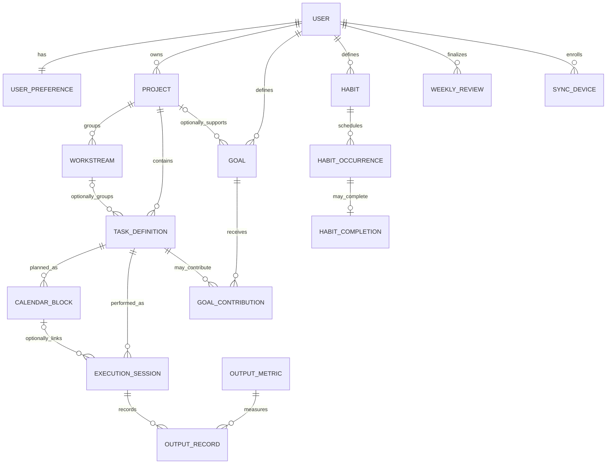

# Data Model and Invariants

## Relationship sketch

Names in the diagram are conceptual. Tables are defined by plain SQL migrations in `apps/api/migrations` (DECISIONS T-006); later stages add their own migrations.

## Implemented in Stage 1 server (`0001_foundation.sql`) — frozen, not part of v1

| Table | Purpose and key constraints |
|---|---|
| `app_user` | Owner account; unique `lower(email)`; scrypt password hash |
| `app_installation` | Singleton row (`CHECK (singleton)`) naming the one owner, which makes setup race-free |
| `sync_device` | Client-generated device IDs, unique per owner (`PRIMARY KEY (user_id, id)`); `revoked_at` |
| `auth_session` | SHA-256 token hash, expiry, revocation; FK to the owner's device |
| `user_preference` | Language, theme, calendar display, week start, nullable IANA time zone, `revision`; CHECK constraints mirror the shared Zod schema |
| `sync_probe` | Stage 1 sync diagnostic record (T-011), not product data and not in v1 backups; `PRIMARY KEY (user_id, id)`; tombstone via `deleted_at` |
| `sync_operation` | Applied push results by `(user_id, op_id)` with request hash, for idempotent retries |
| `change_log` | Append-only per-owner change stream (`seq` identity) read by pull; deletions are `deleted = true` rows |
| `schema_migrations` | Applied migration versions and checksums (created by the runner) |

Foreign keys use `ON DELETE RESTRICT`: nothing referenced by history is removed by cascade.

On the device, IndexedDB (`apps/web/src/local/db.ts`) holds `meta` (device identity, session, cursor, last sync), `preferences`, `probes`, the durable `outbox`, and unresolved `conflicts`. Of these, only `preferences` is product data in the v1 backup; `probes` (`sync_probe`, diagnostic) and the sync tables (`outbox`, session, cursor, sync `conflicts`) belong to the frozen post-v1 sync code and are never exported.

## Entities

- **User:** in v1 there is no account; "the owner" is whoever uses the device. (A future sync service would add an owner account.)
- **Device:** local identity of each installation (UUID and editable name). Used in version vectors and to label backups; never sent anywhere in v1.
- **UserPreference:** language, theme, calendar display, week start, explicit IANA timezone, and capacity preferences.
- **Project / Workstream:** user-created organization. A workstream belongs to one project and is not nestable.
- **TaskDefinition:** reusable task details and recurrence configuration. It is not evidence that work occurred.
- **OutputMetric:** named unit and formatting/aggregation rules (e.g. pages, words, applications). Metric definitions have revisions so historical outputs retain their meaning.
- **Goal / GoalContribution:** a measurable outcome, target/window/status and explicit attribution rules. Progress is derived from sessions, task completion events, and output records.
- **CalendarBlock:** planned occurrence with planned start/end, local-date key, timezone, source recurrence, relationship IDs, and task/project/workstream snapshot/revision.
- **ExecutionSession:** actual work event, planned or unplanned, with task ID, optional block ID, actual timestamps, state, context, notes, and canonical snapshots.
- **OutputRecord:** actual value for a metric and session. Corrections append an audit event rather than replacing the original value.
- **Habit / HabitOccurrence / HabitCompletion:** user-defined recurring activity, planned local-date occurrence, and separate completion record.
- **WeeklyReview:** selected local week, computed immutable summary snapshot, source record IDs/revisions, user observations, and next-week adjustments.
- **Tombstone:** deletion marker (record type, ID, deletion time, version vector) kept locally and exported in backups.
- **PendingConflict / ReplacedVersion / ImportLog (v1, local only):** both versions of an unresolved import conflict; versions replaced by a user's choice (for undo); and the record of each import (backup ID, source device, counts). See `BACKUP_FORMAT.md`.
- **SyncDevice / ChangeLog (after v1, server):** enrolled device cursor and accepted change stream; implemented in the frozen Stage 1 code.

## Core invariants

### Ownership and relationships

- v1: all records on a device belong to the device's user. (After v1, with a server: all private records are scoped by the authenticated owner ID; client-supplied owner IDs are ignored/rejected.)
- A workstream's project must match the task's project.
- A calendar block's task, project, workstream, and snapshots must be mutually consistent at its recorded revision.
- An execution session must reference a task definition owned by the same user; its optional block must reference the same task or an explicitly permitted linked task.
- Deletes of records referenced by history use archive/restrict/tombstone behavior, not destructive cascades.

### Planning versus actual

- CalendarBlock stores intended work and planned duration/output; ExecutionSession and OutputRecord store what happened.
- Creating/editing/deleting an execution never implicitly creates/edits/deletes a CalendarBlock.
- Completing a task definition does not imply a measurable output was produced.
- Actual unplanned sessions are valid without a calendar block.

### Time and recurrence

- Store instants as UTC timestamp-with-time-zone values; retain the relevant IANA timezone and local-date context for interpretation.
- Use date-only values for deadlines and local-date keys for occurrences/review periods.
- Recurrence and configured week boundaries are computed in the user's timezone before conversion to UTC; handle daylight-saving changes.
- Persian UI does not alter Gregorian-based instants or calculations. Calendar choice is explicit.

### Execution state and history

- Running: start exists; end and final state are absent.
- Finished: end and final state are both present; end is not before start.
- Finished sessions are never silently reopened. Any correction/reopen operation must be explicit and audited.
- Historical names/definitions are captured as snapshots when the event is recorded; later edits (and later imports) do not change prior session or block snapshots.
- Corrections to actual outputs preserve original value, attribution, actor/device, timestamp, and reason where appropriate.
- Finalized review snapshots remain stable after preferences, definitions, schedules, or source records change.

### Goals and metrics

- Goal progress is recomputed from underlying records and is rebuildable; cached totals are disposable.
- A session's time/task-count contribution may be linked to at most one goal in the initial scope.
- Output metric values may support multiple goals only through explicit compatible attribution records.
- Pacing uses target, progress, deadline, timezone, active dates, and explicit weekly objective. Do not union multiple task schedules to invent a goal schedule.

### Identity, versions, and merging (v1 backup; also the basis for later sync)

- Every record has a client-created UUID that is never reused; the same ID on two devices means the same item.
- Every record carries a version vector (device ID → edit counter) and a content hash (T-016). A local edit increments only this device's counter.
- Import never deletes and never replaces existing data automatically: new items are added; identical and older copies are skipped; newer-in-backup items need confirmation; edits on both sides, and deletions on either side, become pending conflicts that keep both versions.
- Importing the same backup again changes nothing and creates no duplicates.
- Only product record types are exported; diagnostic and sync-machinery data (`sync_probe`, outbox, session, cursor) never are, and a backup containing them is refused.
- Each record type declares its links. Resolving a conflict on a **linked** record (project, workstream, task, calendar block, session, goal, …) keeps its ID and chooses one version, so links and history stay attached; "keep both" creates a copy only for **independent** record types (no links in either direction).
- Concurrent edits to one mutable record produce an explicit conflict; no silent last-write-wins.
- History events and finalized snapshots are append-only; corrections add records. The same ID with different content in history is an integrity warning, never merged.
- Tombstones are retained and exported (no expiry in v1) and are not confused with ordinary archive state.
- Relationship rules are checked for imported records too; a backup whose references cannot be resolved is refused.

### Sync and concurrency (after v1; implemented in the frozen Stage 1 server code)

- Client-created UUIDs plus idempotency keys prevent duplicate creation on retry.
- Mutable definitions have server revisions and base revision on update (to be adapted to version vectors).
